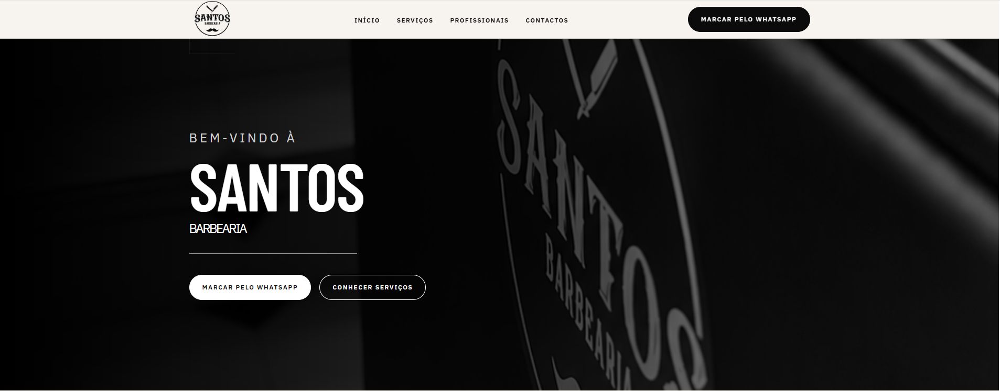

# Santos Barbearia

Website institucional desenvolvido para a **Santos Barbearia**, com foco em presença digital, apresentação dos profissionais, serviços, contactos e marcações através de WhatsApp.

O projeto foi desenvolvido como um trabalho freelance real, desde a recolha de requisitos e tratamento do conteúdo até à implementação responsive e publicação em produção.

## Live website

[https://santosbarbearia.pt](https://santos-barbearia.netlify.app)



## Funcionalidades

- Apresentação da barbearia e dos serviços disponíveis.
- Cartões da equipa com perfis individuais em modal: fotografia, biografia e especialidades.
- Contacto através de WhatsApp e telefone.
- Morada, horários de funcionamento e mapa Google Maps incorporado.
- Ligações para abrir a localização no Google Maps.
- Layout adaptado a dispositivos móveis e desktop.

Os pedidos de marcação são encaminhados para o WhatsApp. O website não gere disponibilidade, reservas, pagamentos ou contas de utilizador.

## Tecnologias

| Tecnologia | Utilização |
| --- | --- |
| React | Composição da interface e gestão do estado de interação |
| TypeScript | Tipagem de propriedades, modelos de conteúdo e funções |
| Tailwind CSS | Estilos, breakpoints e estados de interação |
| HTML semântico | Estrutura da página, contactos e diálogo nativo |
| Google Maps | Visualização da localização através de um iframe |

## Arquitetura

A aplicação separa a composição da página, os componentes reutilizáveis, os dados do negócio e as funções auxiliares.

| Localização | Responsabilidade |
| --- | --- |
| `src/App.tsx` | Composição do cabeçalho, secções e rodapé |
| `src/sections/` | Secções principais: início, apresentação, serviços, equipa e contactos |
| `src/components/layout/` | Elementos estruturais, como `Header`, `Footer` e `Container` |
| `src/components/ui/` | Elementos reutilizáveis, como `CtaLink`, `SectionHeading` e `ImageWithFallback` |
| `src/components/cards/` | Apresentação de serviços e profissionais |
| `src/components/team/` | Diálogo de apresentação de cada profissional |
| `src/data/` | Conteúdo tipado dos serviços e da equipa |
| `src/config/site.ts` | Contactos, morada, horários e configuração do estabelecimento |
| `src/utils/contact.ts` | Construção dos URLs de contacto |
| `public/images/` | Fotografias e imagens utilizadas na interface |

### Estado e fluxo de dados

O estado do perfil selecionado pertence a `TeamSection`. Ao selecionar um cartão, o componente atualiza o profissional ativo e passa os seus dados a `TeamProfileDialog`. Ao fechar o diálogo, a seleção regressa a `null`.

Esta interação é local à secção da equipa e não necessita de uma biblioteca de estado global.

### Decisões técnicas

- **Conteúdo estático:** o âmbito atual é institucional. Manter os dados no código permite uma publicação simples, sem um serviço de backend ou base de dados para administrar.
- **Modelos tipados:** os tipos `TeamMember` e `Service` definem os dados esperados pelos componentes. A lista da equipa utiliza `satisfies` para verificar a sua conformidade com o modelo.
- **Componentes reutilizáveis:** elementos comuns centralizam a apresentação e reduzem duplicação entre secções.
- **Configuração centralizada:** contactos e informação do estabelecimento podem ser atualizados sem procurar os mesmos valores em vários componentes.
- **Diálogo nativo:** o perfil utiliza `<dialog>` e `showModal()`, aproveitando o comportamento modal disponibilizado pelo navegador.
- **Navegação por âncoras:** as secções pertencem à mesma página; o âmbito atual não exige um router.

## Executar localmente

É necessário ter Node.js e um gestor de pacotes compatíveis com o `package.json` e o lockfile do repositório.

Depois de obter o código e abrir um terminal na raiz do projeto, consulte os scripts disponíveis:

```bash
npm run
```

Instale as dependências com:

```bash
npm ci
```

Quando o `package.json` definir o script `dev`, inicia o servidor de desenvolvimento com:

```bash
npm run dev
```

Abrir o endereço apresentado no terminal.


### Equipa

Cada profissional inclui um identificador, nome, função, fotografia, texto alternativo, apresentação, biografia e lista de serviços.

### Serviços

`src/data/services.ts` atualiza os serviços apresentados pelos cartões. Alterações ao modelo devem ser refletidas no tipo `Service` e nos componentes que o utilizam.

### Imagens

As imagens são referenciadas a partir de `/images/`. Ao substituir um ficheiro, verifica o enquadramento em mobile e desktop e otimiza o tamanho sem comprometer a legibilidade.

## Acessibilidade e desempenho

A implementação inclui elementos semânticos, nomes acessíveis para botões de perfil e de fecho, textos alternativos nas fotografias e um título para o mapa incorporado.

O carregamento diferido é utilizado no mapa e em imagens fora da área inicial. A imagem principal tem prioridade de carregamento elevada, e algumas imagens têm dimensões explícitas para ajudar a estabilizar o layout.

## Evolução prevista

As seguintes melhorias são propostas de evolução e não funcionalidades dadas como concluídas:

- [ ] Testes automatizados dos perfis, do preçário e das funções de contacto.
- [ ] Integração contínua com verificação de tipos, lint, testes e build.
- [ ] Medição de desempenho e otimização das imagens com base nos resultados.
- [ ] Metadados de partilha e dados estruturados para pesquisa local.

Um CMS ou sistema de reservas poderá ser considerado se surgir a necessidade de gerir conteúdo sem alterações ao código ou de disponibilizar marcações diretamente no website.

